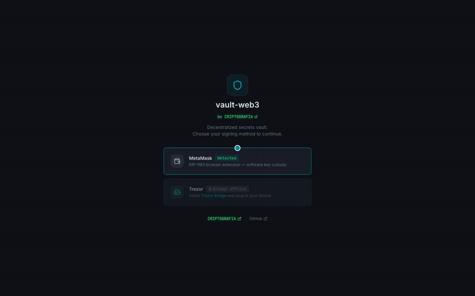
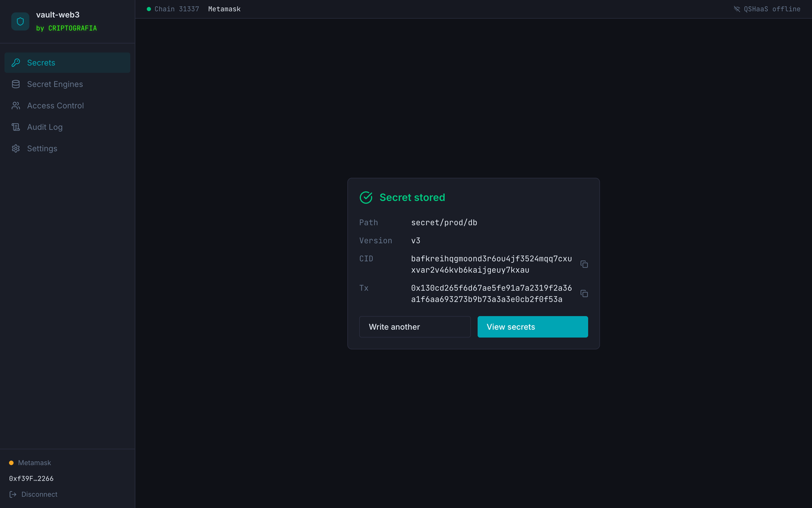
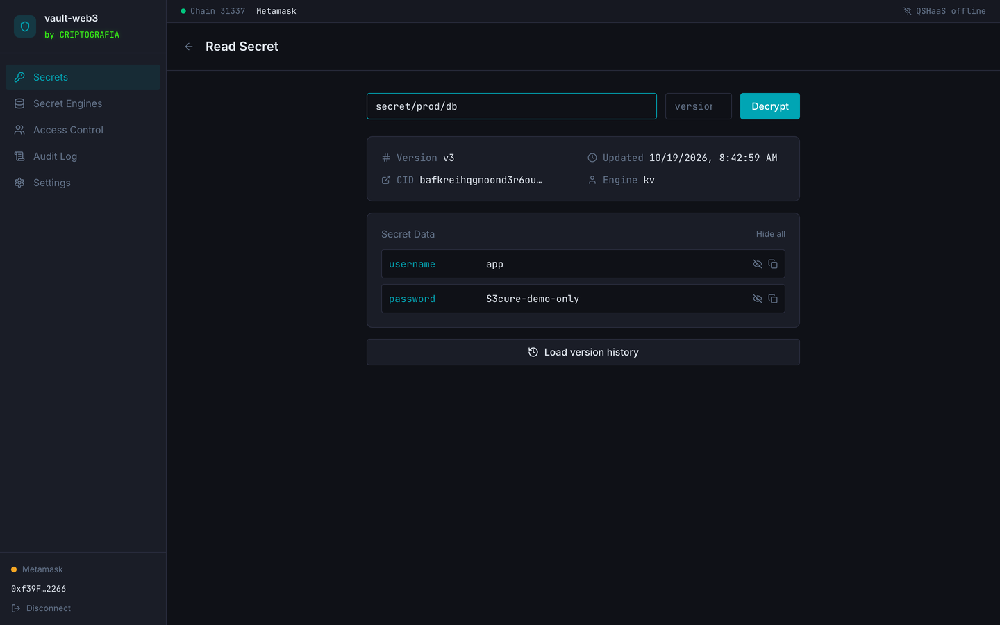
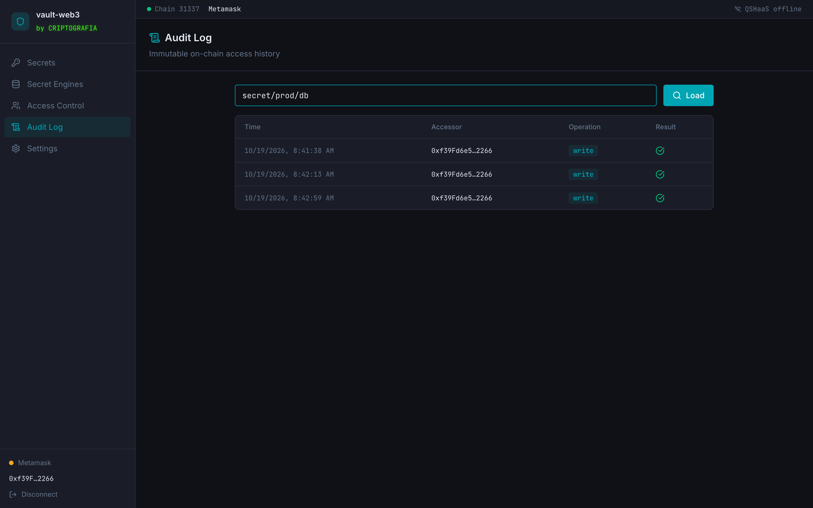
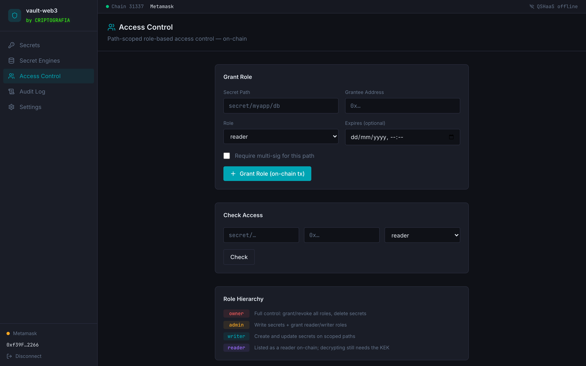

# vault-web3

**Decentralized secrets vault with Trezor hardware root of trust.**

Replaces HashiCorp Vault's seal/unseal mechanism with a hardware key: a Trezor or a YubiKey.
No central server. No root token. No cloud dependency.

**Try the UI:** [vault.criptografia.app](https://vault.criptografia.app). It runs in your browser and follows your wallet's network: Base Sepolia to try it for free, Base for real use. Envelopes are encrypted before they leave the browser and pinned to IPFS through `ipfs.criptografia.app`. The first wallet to write a path owns it. Trezor needs the vault running locally (see Quickstart); YubiKey and MetaMask work on the hosted page. How it's deployed: [docs/deploy.md](docs/deploy.md).

## See it work



The UI against a local chain and IPFS node: connect, encrypt and store, decrypt, audit. Recorded with a test wallet standing in for MetaMask; nothing here is mocked past the wallet.

| Stored: IPFS CID and on-chain tx | Decrypted |
|---|---|
|  |  |
| **On-chain audit log** | **Path-scoped roles** |
|  |  |

Tests and the end-to-end check, in the terminal:


## Architecture

```
Trezor (KEK from a signed message) · YubiKey (KEK from FIDO2 PRF) · MetaMask (EIP-712)
  ↓
AES-256-GCM (wrap DEK) + AES-256-GCM (encrypt payload) + HMAC integrity tag
  ↓
IPFS (encrypted envelope stored as CIDv1 content-addressed blob)
  ↓
L2 Smart Contract (ERC-2535 Diamond: CID versioning + RBAC + audit log)
```

See [docs/architecture.md](docs/architecture.md) for full diagrams.

## Signers

| Signer | Where the key lives | Unlock | Signs transactions |
|---|---|---|---|
| **Trezor** | Hardware wallet | Confirm on the device | Yes |
| **YubiKey** | FIDO2 security key (PRF) | Touch + PIN | No, pair it with a browser wallet |
| **MetaMask** | Browser extension | Wallet popup | Yes |

Each signer derives its own keys: a secret is read with the same signer (and the same key) that wrote it. YubiKey setup and troubleshooting: [docs/yubikey.md](docs/yubikey.md).

## Quickstart

### 1. Start the stack

```bash
docker compose up -d
```

### 2. Deploy contracts

```bash
cd packages/contracts
npm install
npx hardhat run scripts/deploy.ts --network localhost

# Note the Diamond address, then configure:
vault-web3 config set registryAddress 0x...
vault-web3 config set rpcUrl http://127.0.0.1:8545
vault-web3 config set ipfsApiUrl http://127.0.0.1:5001
```

### 3. Connect Trezor

Install [Trezor Bridge](https://suite.trezor.io/web/bridge/) on the host.

```bash
vault-web3 status
```

### 4. Write and read secrets

```bash
# Write (requires 2x Trezor confirmation: KEK derivation + tx signing)
vault-web3 write secret/myapp/db password=s3cr3t host=db.internal port=5432

# Read (requires 1x Trezor confirmation: KEK derivation)
vault-web3 read secret/myapp/db

# List versions (on-chain history)
vault-web3 versions secret/myapp/db

# Grant read access
vault-web3 policy attach secret/myapp/db --address 0xAbCd... --role reader

# View audit log (on-chain, immutable)
vault-web3 audit secret/myapp/db
```

## CLI Reference

| Command | Description |
|---------|-------------|
| `vault-web3 write <path> key=val...` | Encrypt and store a secret |
| `vault-web3 read <path>` | Decrypt and print a secret |
| `vault-web3 delete <path>` | Write tombstone (soft delete) |
| `vault-web3 versions <path>` | List on-chain version history |
| `vault-web3 policy attach <path> --address --role` | Grant role |
| `vault-web3 policy detach <path> --address` | Revoke role |
| `vault-web3 policy check <path> --address --role` | Check access |
| `vault-web3 audit <path>` | Show on-chain audit log |
| `vault-web3 config set <key> <val>` | Configure client |
| `vault-web3 status` | Check IPFS, chain, Trezor connectivity |

## REST API (HashiCorp Vault KV v2 compatible)

The API runs on port 8200 (same default as HashiCorp Vault):

```bash
# Write
curl -X POST http://localhost:8200/v1/secret/data/myapp/db \
  -H 'Content-Type: application/json' \
  -d '{"data": {"password": "s3cr3t"}}'

# Read
curl http://localhost:8200/v1/secret/data/myapp/db

# Health
curl http://localhost:8200/v1/web3/health
```

## Packages

| Package | Description |
|---------|-------------|
| `packages/core` | Trezor integration, envelope encryption, IPFS + registry clients |
| `packages/cli` | `vault-web3` CLI (Commander.js) |
| `packages/api` | Fastify REST API (HashiCorp Vault KV v2 compatible) |
| `packages/contracts` | ERC-2535 Diamond smart contracts (Hardhat) |

## Security

See [docs/threat-model.md](docs/threat-model.md) for full threat analysis vs HashiCorp Vault.

**Key properties:**
- KEK never leaves the Trezor device (derived on-device, used in memory <50ms)
- Every write requires physical Trezor button confirmation
- Audit trail is immutable (on-chain events cannot be deleted)
- No persistent server process to compromise

## Migration from HashiCorp Vault

See [docs/migration-guide.md](docs/migration-guide.md).

## Multi-sig Unsealing

For high-security secrets requiring M-of-N Trezors:

```typescript
import { TrezorVault } from "@vault-web3/core";

// Collect shares from 2 devices
const vault = new TrezorVault(config);
const shareA = await vault.collectThresholdShare("secret/nuclear/codes", 0);
// (Repeat on second device)
const shareB = await vault2.collectThresholdShare("secret/nuclear/codes", 0);

// Combine
const keys = await vault.deriveThresholdKEK(
  { shares: [shareA, shareB], threshold: 2, commitment: "..." },
  "secret/nuclear/codes"
);
```

### End-to-end check

With the stack up and the contracts deployed, this writes, reads, rotates and audits a secret against the real chain and IPFS node. A software key stands in for the Trezor and signs the same message the device would:

```bash
npm run build
REGISTRY=0x<diamond address> npm run e2e
```

## License

MIT
