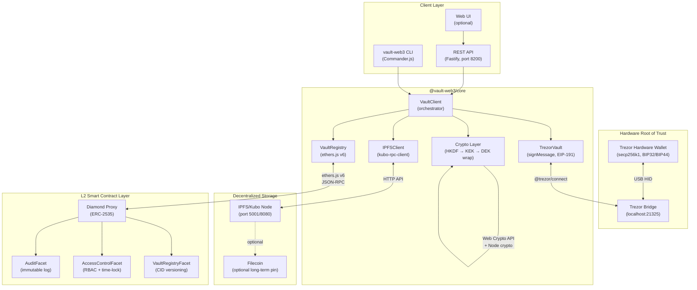

# Web3 Secrets Vault — System Architecture

## System Diagram



## Write Secret Flow

```
User                   CLI/API         TrezorVault         Crypto         IPFS         Registry (L2)
 │                        │                 │                 │              │                │
 │  write secret/app/db   │                 │                 │              │                │
 │ ──────────────────────>│                 │                 │              │                │
 │                        │  signTypedData  │                 │              │                │
 │                        │ ──────────────>│                 │              │                │
 │                        │                 │                 │              │                │
 │  [Trezor screen shows: │                 │                 │              │                │
 │   "KEK derivation for  │                 │                 │              │                │
 │    secret/app/db"]     │                 │                 │              │                │
 │  ◄── confirm button ──│                 │                 │              │                │
 │                        │  sig(65 bytes)  │                 │              │                │
 │                        │ <─────────────│                 │              │                │
 │                        │                 │ HKDF(sig,ns)    │              │                │
 │                        │                 │ ──────────────>│              │                │
 │                        │                 │                 │ KEK (32B)    │                │
 │                        │                 │                 │<──────────  │                │
 │                        │                 │                 │ genDEK()     │                │
 │                        │                 │                 │ AES-GCM(KEK,DEK)→encDEK      │
 │                        │                 │                 │ AES-GCM(DEK,payload)→cipher   │
 │                        │                 │                 │ envelope{}   │                │
 │                        │                 │                 │ ──────────>│                │
 │                        │                 │                 │              │ pin → CID      │
 │                        │                 │                 │              │<──────────    │
 │                        │                 │                 │              │                │
 │                        │  signTx (on-chain record)         │              │                │
 │                        │ ──────────────>│                 │              │                │
 │  [Trezor screen shows: │                 │                 │              │                │
 │   "Sign tx: recordVer" │                 │                 │              │                │
 │  ◄── confirm button ──│                 │                 │              │                │
 │                        │                 │                 │              │ recordVersion(path,CID)
 │                        │                 │                 │              │ ──────────────>│
 │                        │                 │                 │              │                │ emit event
 │  ✓ stored, v2, tx=0x.. │                 │                 │              │                │
 │ <──────────────────────│                 │                 │              │                │
```

## Read Secret Flow

```
User                   CLI/API         Registry (L2)    IPFS         TrezorVault       Crypto
 │                        │                 │              │                │              │
 │  read secret/app/db    │                 │              │                │              │
 │ ──────────────────────>│                 │              │                │              │
 │                        │  getLatestVersion(path)        │                │              │
 │                        │ ──────────────>│              │                │              │
 │                        │  v=2, CID=baf..│              │                │              │
 │                        │ <─────────────│              │                │              │
 │                        │                 │ fetch(CID)   │                │              │
 │                        │                 │ ────────────>│                │              │
 │                        │                 │ envelope{}   │                │              │
 │                        │                 │ <────────── │                │              │
 │                        │ signTypedData   │              │                │              │
 │                        │ ──────────────────────────────>│                │              │
 │  [Trezor screen shows: │                 │              │                │              │
 │   "KEK derivation for  │                 │              │                │              │
 │    secret/app/db"]     │                 │              │                │              │
 │  ◄── confirm button ──│                 │              │                │              │
 │                        │ sig(65 bytes)   │              │                │              │
 │                        │ <─────────────────────────────│                │              │
 │                        │                 │              │ HKDF(sig)→KEK  │              │
 │                        │                 │              │ ─────────────────────────────>│
 │                        │                 │              │ AES-GCM-unwrap DEK           │
 │                        │                 │              │ AES-GCM decrypt payload       │
 │                        │                 │              │ verify hash                   │
 │                        │ plaintext{}     │              │                │              │
 │                        │ <─────────────────────────────────────────────────────────────│
 │  {password: "xxx"}     │                 │              │                │              │
 │ <──────────────────────│                 │              │                │              │
```

## Key Derivation Hierarchy

```
Trezor BIP32 Seed (never leaves device)
│
├── m/44'/60'/0'/0/0     ← Ethereum address for on-chain identity & tx signing
│
└── Message signing (EIP-191, same path, different operation)
    │
    ├── sign("vault-web3:kek:v1:secret/app/db:0")
    │   └── signature(65 bytes) → HKDF-SHA256 → KEK₀ for "secret/app/db"
    │
    ├── sign("vault-web3:kek:v1:secret/app/db:1")
    │   └── KEK₁  ← key rotation without re-derivation path change
    │
    └── sign("vault-web3:kek:v1:ssh/prod:0")
        └── KEK for "ssh/prod"  ← different namespace = different KEK

KEK → AES-256-GCM-Wrap → encDEK (stored in IPFS envelope)
DEK → AES-256-GCM → encPayload (stored in IPFS envelope)
KEK → HKDF → HMAC-SHA256(plaintext) → integrity tag (stored in IPFS envelope and on-chain)
```

## Multi-Sig Threshold Unsealing

```
Device A (0xABC...)                Device B (0xDEF...)
    │                                    │
    │ sign(VaultAuth{ns, idx=0})         │ sign(VaultAuth{ns, idx=0})
    │                                    │
    ▼                                    ▼
 sig_A (65B)                         sig_B (65B)
    │                                    │
HKDF(sig_A, salt=ns:0xABC)         HKDF(sig_B, salt=ns:0xDEF)
    │                                    │
 shareKEK_A (32B)                   shareKEK_B (32B)
    │                                    │
    └──────────────── XOR ───────────────┘
                       │
                  combinedKEK (32B)
                       │
              AES-256-GCM-Unwrap encDEK
                       │
                      DEK
                       │
              AES-256-GCM decrypt
                       │
                   plaintext

NOTE: For true M-of-N (not exactly-M-of-N), replace XOR with
Shamir Secret Sharing on the combinedKEK. See packages/core/src/crypto.ts.
```

## Diamond Proxy Storage Layout

```
Diamond (proxy, ERC-2535)
│
├── keccak256("diamond.standard.diamond.storage")
│   └── DiamondStorage { selectorToFacet, facetAddresses, owner, ... }
│
└── keccak256("vault.web3.registry.storage.v1")
    └── VaultStorage {
          versions:    pathKey → version → SecretVersion { cid, hash, ts, author }
          latestVersion: pathKey → uint256
          policies:    pathKey → grantee → PolicyEntry { role, expiresAt, ... }
          auditLog:    pathKey → AuditEntry[]
          paused:      bool
        }
```
