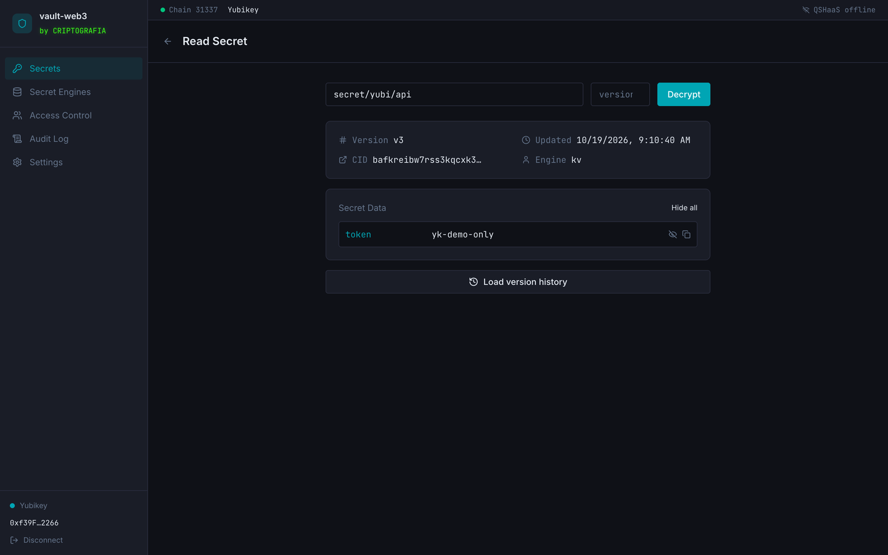
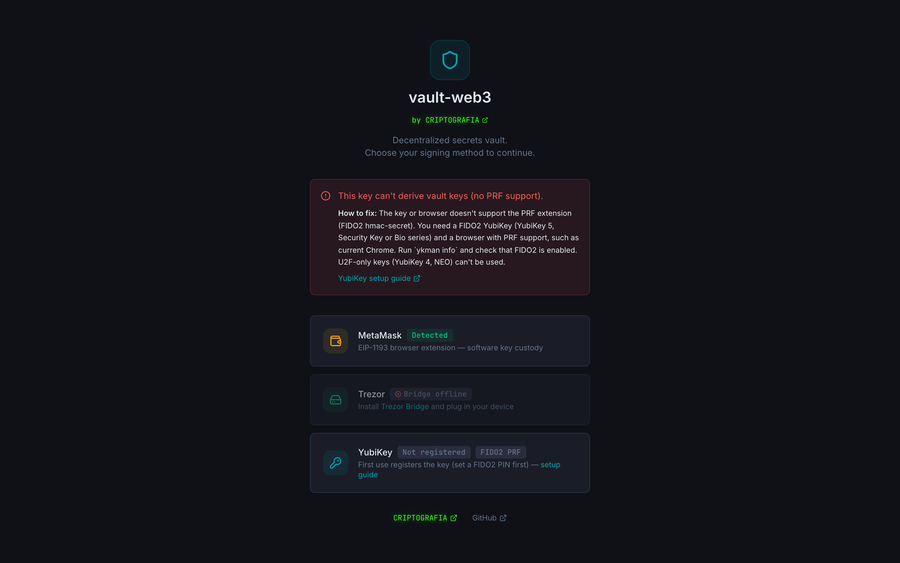

# Using a YubiKey

vault-web3 can use a YubiKey instead of a Trezor to protect your secrets. One touch on the key unlocks a secret; nothing that can decrypt it ever leaves the key except for that one operation.

## How it works

A YubiKey's normal signatures are randomized, so they can't be turned into a key that comes out the same every time. vault-web3 uses the key's **PRF** feature instead (WebAuthn PRF, built on FIDO2 `hmac-secret`): the key holds a secret that never leaves it, and for each secret path it computes

```
salt = SHA-256("vault-web3:kek:v1:<path>:<index>")
PRF  = HMAC-SHA256(secret on the key, salt)     ← 32 bytes, same every time
KEK  = HKDF-SHA256(PRF, ...)                     ← same derivation as the Trezor path
```

A YubiKey can't sign Ethereum transactions, so you also need a browser wallet (MetaMask or any EIP-1193 wallet). **The YubiKey protects the secrets. The wallet only signs the registry transactions** (recording a new version on-chain).

## What you need

- A YubiKey with FIDO2: **YubiKey 5 series, Security Key series or YubiKey Bio**. Older keys that only do U2F (YubiKey 4, NEO, the original blue U2F key) can't be used.
- A browser with WebAuthn PRF. It's tested in Chrome; current Edge and Brave work the same way. Recent Safari and Firefox versions support PRF too; if yours doesn't, vault-web3 tells you so.
- The vault served over `https://` or on `localhost`. Browsers block security keys anywhere else.
- A browser wallet for the on-chain writes.

| Unlocked with a YubiKey | A key that isn't ready gets a fix |
|---|---|
|  |  |

## Set up the key (once)

1. **Install YubiKey Manager**, the `ykman` command line tool:
   ```bash
   brew install ykman            # macOS
   sudo apt install yubikey-manager   # Debian/Ubuntu
   ```
   Or use the Yubico Authenticator app, which has the same settings in a window.

2. **Check the key does FIDO2:**
   ```bash
   ykman info
   ```
   Look for `FIDO2` under **Enabled USB interfaces**. If it's listed as supported but not enabled:
   ```bash
   ykman config usb --enable FIDO2
   ```

3. **Set a FIDO2 PIN.** vault-web3 asks the key to verify you on every unlock, and the key can't do that without a PIN:
   ```bash
   ykman fido access change-pin
   ```
   (Yubico Authenticator: **Passkeys → Set PIN**.) Eight wrong PINs in a row lock FIDO2 on the key, and resetting it deletes every FIDO2 credential on it, including vault-web3's.

## Use it

1. Open the vault, make sure your browser wallet is unlocked, and click **YubiKey** on the connect screen.
2. **First time only:** the browser asks you to create a passkey on the security key. Enter the PIN and touch the key. This registers it.
3. Touch the key once more. vault-web3 checks that it can derive keys before letting you in, so a key that isn't ready fails here, with a fix, rather than halfway through a write.
4. From then on, every write and read asks for one touch (and the PIN, if the browser asks).

The registration is remembered in this browser (`localStorage`, key `vault-web3-yubikey`). It holds only the credential ID, which isn't secret.

## If it isn't ready

The connect screen shows what went wrong and how to fix it. The same messages:

| You see | Why | Fix |
|---|---|---|
| This browser can't talk to security keys | No WebAuthn | Use a current Chrome, Edge, Brave, Safari or Firefox |
| Security keys need a secure page | Page isn't https or localhost | Open the vault on `https://` or `http://localhost` |
| This key can't derive vault keys (no PRF support) | U2F-only key, or a browser without PRF | Check `ykman info` for FIDO2; try Chrome |
| The YubiKey has no FIDO2 PIN yet | No PIN set | `ykman fido access change-pin` |
| The YubiKey wasn't touched in time | Prompt timed out or was cancelled | Plug it in, click again, touch the gold contact when it blinks |
| That's not the registered YubiKey | A different key is plugged in | Use the key you registered, or register this one (see below) |
| No YubiKey registered yet | First use in this browser | Click **YubiKey** and follow the prompts |
| A YubiKey can't sign Ethereum transactions | No browser wallet | Install MetaMask or another browser wallet |

Still stuck: unplug the key, plug it back in, and try once more. `ykman fido info` shows whether the PIN is set and how many tries are left.

## Before you rely on it

- **One key, one set of secrets.** Each YubiKey derives different keys. A secret written with key A can only be read with key A. If you lose it, those secrets are gone. vault-web3 doesn't yet wrap a secret for more than one key; until it does, keep a second copy of anything you can't afford to lose (for example, written again with your Trezor under another path).
- **The site's domain is part of the key.** WebAuthn ties the credential to the domain the vault runs on (`localhost`, `vault.criptografia.app` for the hosted UI, or your own domain). The same YubiKey on a different domain derives different keys and can't read secrets written on the first one. Pick the domain before storing real secrets.
- **Registering another key.** "Use a different YubiKey" on the connect screen forgets the registered one in this browser. It doesn't delete anything from the old key, and the old key still reads what it wrote.
- **Tested how.** The YubiKey path has unit tests with a mocked key (`packages/core/src/__tests__/yubikey.test.ts`) and a browser test against Chrome's virtual FIDO2 authenticator with PRF: register, write, read, a second key denied, and a key without PRF showing the fix. It has not been tried on every physical YubiKey model; reports welcome.
